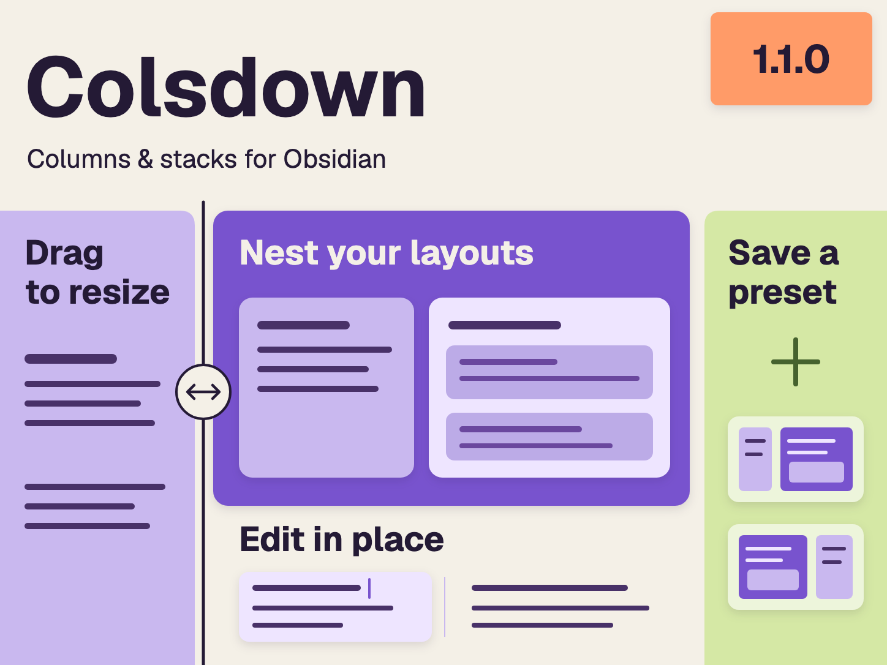
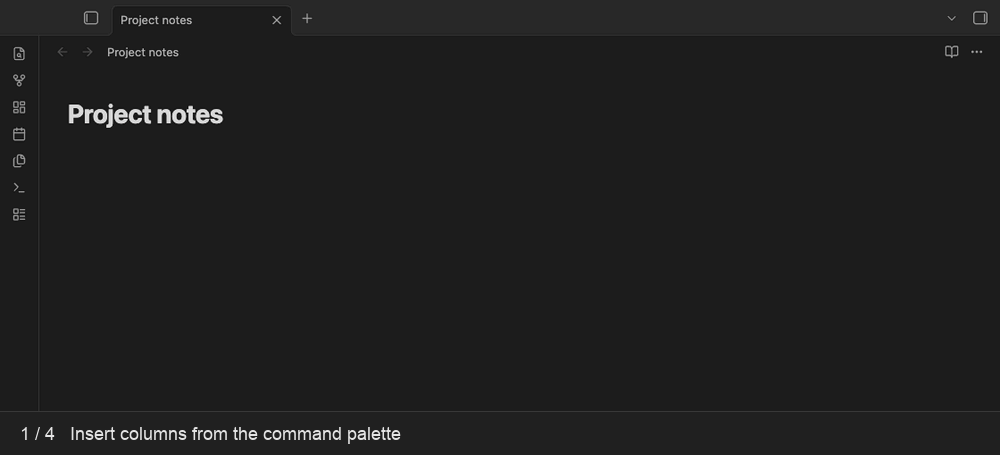

# Colsdown

Responsive Markdown columns and stacks for Obsidian. Works in Reading View and Live Preview, using your theme’s styles.



<p align="center">
<a href="https://obsidian.md/plugins?id=colsdown"><picture><source media="(prefers-color-scheme: dark)" srcset="https://shieldcn.dev/badge/Install_in_Obsidian.svg?variant=default&amp;size=sm&amp;font=geist&amp;mode=dark&amp;logo=obsidian&amp;color=a079ff&amp;logoColor=18181b&amp;valueColor=18181b&amp;labelTextColor=18181b&amp;gradient=a079ff%2Cac8aff%2C110"></picture></a>
<picture><source media="(prefers-color-scheme: dark)" srcset="https://shieldcn.dev/group/github/release/grafanaKibana/obsidian-colsdown/stable+github/ci/grafanaKibana/obsidian-colsdown.svg?variant=outline&amp;size=sm&amp;font=geist&amp;mode=dark&amp;workflow=ci.yml&amp;branch=main"></picture>
</p>

<p align="center">
<a href="https://github.com/grafanaKibana/obsidian-colsdown/releases/latest">Release notes</a> · <a href="https://github.com/grafanaKibana/obsidian-colsdown/actions/workflows/ci.yml">CI details</a>
</p>

- **Write in place:** in Live Preview, edit one column while its neighbors stay rendered.
- **Keep moving:** arrows navigate between columns and into or out of the layout; Cmd/Ctrl+A selects the active column’s text.
- **Choose your syntax:** compact comment markers or fenced code blocks, with the same layout features.
- **Shape your layout:** resize, add columns, nest layouts, create stacks, and reuse presets. Columns adapt to narrow panes.

<details>
<summary>Watch Colsdown in Obsidian</summary>



</details>

## Get started

Run **Colsdown: Insert 2 columns** from the command palette, then replace the placeholders:

```markdown
%% cols %%
Left content

%% col %%
Right content
%% endcols %%
```

Content after `cols` is the first column; each `col` starts another. Keep markers on their own lines. Click a column or enter with the arrows to edit in Live Preview. Use Source Mode to change layout markers or fences.

- **Widths:** use `%% col:60 %%` for 60% or `%% col:2fr %%` for a fractional width. Omit the width for automatic sizing; the first column shares the remaining space. An explicit first `col` can set its width or keep it empty.
- **Resize:** drag a divider or focus it and use arrow keys. Widths save on release; Escape cancels.
- **Add:** select **+** to append a column.
- **Stack:** start with `%% cols:stack %%` for vertical sections.

Columns can contain ordinary Markdown, footnotes, code blocks, and nested layouts. They stack automatically in narrow panes.

## Prefer code blocks?

Choose **Settings → Colsdown → Insertion format → Code block**. The same commands and presets will insert fenced layouts:

````markdown
```colsdown
Left content

::: 60%
Right content
```
````

Use `stack` instead of `colsdown` for vertical sections. Make an outer fence longer than any code fences nested inside it.

Settings also provide spacing, dividers, responsive sizing, and named presets.

## Guides

[Marker examples](demo/Colsdown%20markers.md) · [Fenced layouts](demo/Colsdown%20fenced%20layouts.md) · [Nested layouts](demo/Colsdown%20nested%20layouts.md) · [Demo test matrix](demo/Colsdown%20test%20matrix.md)

## Install

Install with [BRAT](https://github.com/TfTHacker/obsidian42-brat) using `grafanaKibana/obsidian-colsdown`, or copy `main.js`, `manifest.json`, and `styles.css` from the same [release](https://github.com/grafanaKibana/obsidian-colsdown/releases) into `<Vault>/.obsidian/plugins/colsdown/`. Reload Obsidian and enable **Colsdown**.

Runs locally on desktop and mobile, with no network requests, telemetry, or account.

[Report an issue](https://github.com/grafanaKibana/obsidian-colsdown/issues) · [Contributing](CONTRIBUTING.md) · [MIT license](LICENSE)
